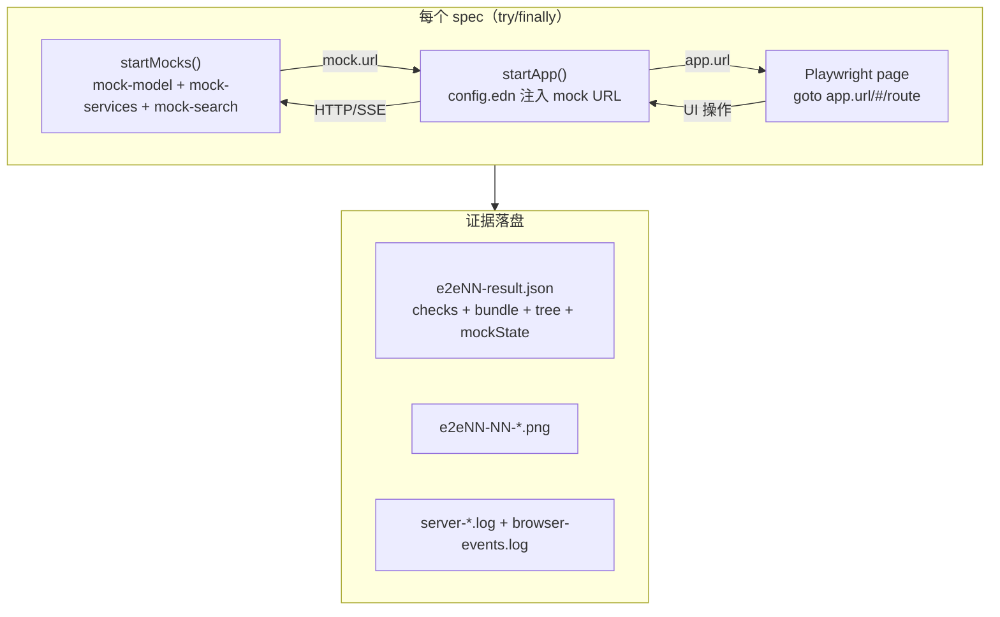

# 0.0.2 S2 · E2E 自动化骨架设计（D-04 收口）

> 日期：2026-11-07 · 作者：w132-s2-e2e · 范围：只读调研 + 本设计文档；不改 `src/`、`test/`、`package.json`。
> 目标：把 0.0.1 的 22 条手工/真实端点 E2E 证据升级为 §8.5 要求的自动化口径——mock 模型服务 + mock OAuth/WebDAV/S3 + Playwright harness，核心剧本 ≥8 条自动化，其余保留手工证据并标注口径。

## 0 现状盘点（已核实）

### 0.1 已有资产

| 资产 | 位置 | 状态 |
|---|---|---|
| Playwright 配置 | `test/e2e/playwright.config.mjs` | `workers:1`、`fullyParallel:false`、`retries:0`、timeout 240s、headless Chrome（`/usr/bin/google-chrome` 或 `CHROME_PATH`）、`--js-flags=--max-old-space-size=512`、`--disable-dev-shm-usage`、`screenshot:only-on-failure`、`trace/video:retain-on-failure`；reporter = list + JSON + HTML，输出到 `plans/evidence/e2e-auto/` |
| App 启动器 | `test/e2e/support/app.mjs` | `startApp({port:0, models, workspaceFiles, evidenceDir, keepTemp})`：`mkdtemp hc-e2e-*` 独立 data/workspace/blobs/worktrees/artifacts/tmp；生成 `config.edn`（`:model-stream? true`、`:fleet` 关预检/GC）；spawn `clojure -J-Xmx768m -J-XX:MaxDirectMemorySize=512m -J-XX:+ExitOnOutOfMemoryError -M:server -m hc.server.app --config`；stdout 正则抓 `Herdchestra listening on http://127.0.0.1:<port>` + `/healthz` 轮询；SIGTERM→15s→SIGKILL + POSIX orphan watchdog；`close()` 默认删 tempRoot |
| Mock 模型 | `test/e2e/support/mock-model.mjs` | `startMockModel(options)`：`GET /v1/models`（mock-fast/long/tool）、`POST /v1/chat/completions`（SSE `chat.completion.chunk` + `[DONE]` + 非流式 `chat.completion` + `usage` + `tool_calls` delta）、`POST /__mock/config`（reply/chunkSize/chunkDelayMs/errorStatus/failAfterChunks/forceToolCall 热改）、`GET /__mock/state`、`POST /__mock/reset`；请求日志 ring buffer ≤200；所有响应带 `x-herdchestra-mock: model` |
| Mock 外部服务 | `test/e2e/support/mock-services.mjs` | `startMockOAuth()` / `startMockWebDAV()` / `startMockS3()` / `startMockExternalServices()`；三服务独立 `listen(0)` 随机端口；OAuth 有 device code + authorize 302 + token 三 grant + userinfo + revoke；WebDAV 有 PROPFIND/PUT/GET/HEAD/DELETE/MKCOL/OPTIONS；S3 有 path-style PUT/GET/HEAD/DELETE + ListBucket v1 XML；统一 `x-herdchestra-mock` 头、请求日志 ≤200、body ≤1MiB、总量 ≤16MiB |
| UI helpers | `test/e2e/support/ui.mjs` | `goto`（hash 路由）、`waitForShell/waitForSync/waitForSettingsSync`、`composer/newSession/selectFirstSession/send`、`assistantTexts/userTexts/lastAssistantText`、`turnLive/stopButton/ensureIdle/waitForAssistant`（轮询+quietMs 判定流式结束）、`settingsAddLocalConnection/settingsEnableConfiguredConnection/settingsEnableModelAndBindMain/sessionModelLabel`、`evidenceDir/writeJson/shot/assert/assertEqual/clientBundleInfo`（sha256+mtime） |
| 已有 spec | `test/e2e/` | `e2e-01-empty-install.spec.mjs`（@core，单 test，420s，D-12 阻塞路径已内置）、`e2e-03-streaming-draft.spec.mjs`（@core，单 test）、`e2e-09-protected-commit.spec.mjs`（@core，server-side + `e2e09_workspace.clj` 驱动）、`mock-services.spec.mjs`（@mock，纯 fetch 断言三 mock 最小契约）、`memory.spec.mjs`（@memory，300 次循环断言有界） |
| npm scripts | `package.json` | `e2e`、`e2e:core`（`--grep @core`）、`e2e:mock`、`e2e:memory` |
| 证据目录 | `plans/evidence/e2e-auto/` | `e2e01/`、`e2e03/`、`e2e09/`、`mock-services/`、`memory/` + `playwright-results.json` + `playwright-artifacts/` + `playwright-report/` |

### 0.2 已确认的缺口

1. **mock OAuth 路径与真实客户端契约不一致**（侦察确认）：客户端 `src/hc/server/model_auth/oauth.clj` 期望 `/authorize`、`/token`、`/device_authorization`、`/userinfo`、`/revoke`（无 `/oauth/` 前缀）；现有 mock 用 `/oauth/authorize`、`/oauth/token`、`/oauth/device/code`、`/oauth/userinfo`、`/oauth/revoke`。authorize 不校验 `code_challenge`/`redirect_uri`；token 不校验 `code_verifier`（PKCE S256）；device grant 不支持 `authorization_pending`/`slow_down` 轮询语义；`verification_uri` 无对应用户确认页。**必须按 `test/hc/server/model_auth/support.clj` 的 `start-oauth-server` 对齐**。
2. **app.mjs 只支持 `:openai-compatible` 连接**：`connectionEdn` 硬编码 `:kind :openai-compatible`。OAuth 连接需 `:kind :oauth` + `:model-auth` provider 注入（`HC_CONFIG` 顶层 `:model-auth {:providers {:local {...}}}`）；备份目标需 `:backup {:targets {...} :default-target-id ...}`。**config.edn 生成器需扩展**。
3. **无 mock 搜索服务**：E2E 07 需要 Brave/SearXNG/本地搜索 stub；现有 mock-services.mjs 无搜索端点。
4. **无 mock 记忆/语音服务**：E2E 11/15 依赖 Herdchestra 自身的记忆/语音功能（服务端已有 loopback 测试先例），不需外部 mock，但 UI 驱动缺失。
5. **证据 JSON 无 tree hash**：现有 `clientBundle` 只有 `sha256`+`mtime`；0.0.1 手工证据双记 bundle+树（`find src test -type f | sort | xargs sha256sum | sha256sum`）。自动化证据需新增 `sourceTreeSha256` 字段。
6. **D-12 阻塞**：E2E 01 的「新建连接→声明 tools→发送」路径在 0.0.1 自动化 FAIL（`MODEL_TOOLS_UNAVAILABLE`），产品修复由功能线（W-F3）负责；E2E spec 已内置 D-12 失败路径，产品修复后自动转 PASS。

## 1 Mock 服务架构

### 1.1 设计原则

- **进程内 mock，独立端口**：所有 mock 服务是 `node:http` 服务器，`listen(0,'127.0.0.1')` 由 OS 分配端口；与 Herdchestra app 进程、Playwright 浏览器同机但进程隔离。mock 不跨 spec 共享状态（每个 spec/fixture 自启自停）。
- **最小真实契约**：mock 只实现客户端实际调用的端点与字段，不模拟真实第三方的完整 API（无分页游标、多版本、ACL、速率限制）。所有响应带 `x-herdchestra-mock` 头与 `mock:true` 标记，证据可审计。
- **可编程剧本**：mock 通过 `POST /__mock/config` 热改行为（reply 文本、chunkSize/chunkDelayMs、errorStatus、failAfterChunks、forceToolCall、OAuth device approved 状态、WebDAV/S3 初始文件等），替代「每剧本一个 stub 实例」的 0.0.1 做法。
- **有界资源**：请求日志 ring buffer ≤200、单请求体 ≤1MiB、存储总量 ≤16MiB（沿用现有 mock-services.mjs 常量）；memory.spec.mjs 已验证 300 次循环不泄漏。
- **生命周期**：mock 服务在 spec 的 `try/finally` 中 `close()`；与 app 的 `close()` 并发执行。Playwright `workers:1` 保证同一时刻只有一个 spec 持有 mock+app 组合，避免端口/状态竞争。

### 1.2 启动方式：fixture（非 globalSetup/webServer）

**决策：不用 Playwright `globalSetup` 或 `webServer`，用 per-spec fixture。**

理由：
- `webServer` 适合「一个服务多 spec 共享」，但 Herdchestra E2E 每个剧本需要**独立 app 实例**（独立 data-dir/端口）+ **独立 mock 状态**（请求计数、文件树、OAuth 授权状态互不污染）。`webServer` 的单例生命周期与此冲突。
- `globalSetup` 只跑一次，无法为每个 spec 提供独立 mock；且 mock 需要与 app 的 `config.edn` 联动（mock URL 注入连接配置），时序上必须在 `startApp` 之前拿到 mock 端口。
- 现有 `startMockModel()`/`startMockExternalServices()`/`startApp()` 已是 async 函数，per-spec `test.beforeEach`/`try-finally` 模式最自然。

**fixture 结构**（新增 `test/e2e/support/fixtures.mjs`）：

```js
// 伪代码：per-spec 组合启动器
export async function startStack(options = {}) {
  // 1. 并行启动所有需要的 mock
  const mocks = await startMocks(options.mocks); // {model, oauth, webdav, s3, search}
  // 2. 用 mock URL 构造 models/backup/modelAuth 配置
  const appOptions = buildAppOptions(mocks, options.app);
  // 3. 启动 Herdchestra app
  const app = await startApp(appOptions);
  return { mocks, app, async close() { await app.close(); await mocks.close(); } };
}
```

`startMocks` 按需启动子集（`{model:true, external:true, search:true}`），避免无关 mock 浪费端口/内存。

### 1.3 各 mock 服务契约（0.0.2 目标形态）

#### 1.3.1 Mock 模型服务（`mock-model.mjs`，扩展现有）

| 端点 | 方法 | 说明 |
|---|---|---|
| `/v1/models` | GET | 返回 `mock-fast`/`mock-long`/`mock-tool`/`mock-vision`/`mock-slow` 等；`mock-vision` 声明 `:vision` 能力 |
| `/v1/chat/completions` | POST | `stream:true` → SSE chunk（content/tool_calls/usage 尾包）；`stream:false` → 完整 `chat.completion`；支持 `errorStatus`/`failAfterChunks`/`forceToolCall` |
| `/__mock/state` | GET | `{requests[], chatCompletions, active, aborted, config, last}` |
| `/__mock/config` | POST | 热改 reply/chunkSize/chunkDelayMs/errorStatus/failAfterChunks/forceToolCall/script |
| `/__mock/reset` | POST | 清空计数与请求日志 |

**需新增能力**：
- `script` 配置：按请求序号或消息内容返回不同 reply（E2E 04/05 需要多轮不同回复；E2E 02 需要同名模型在不同连接返回不同内容）。
- `mock-slow`：首 token 延迟可配（测取消/超时）。
- `mock-vision`：声明 vision 能力，用于 E2E 06 能力路由。
- tool_calls 多轮：当前 `forceToolCall` 只回固定 `mock_echo`；E2E 08/10 需要「tool_call → 结果 → 继续」的多轮脚本。

#### 1.3.2 Mock OAuth 服务（`mock-services.mjs`，重写路径对齐客户端）

按 `test/hc/server/model_auth/support.clj` 的 `start-oauth-server` 契约重写：

| 端点 | 方法 | 契约 |
|---|---|---|
| `/authorize` | GET | 读 `response_type=code&client_id&redirect_uri&scope&state&code_challenge&code_challenge_method=S256`；存 `{code → {redirect_uri, code_challenge}}`；302 到 `redirect_uri?code=<code>&state=<state>` |
| `/token` | POST | form：`grant_type` ∈ `authorization_code`/`urn:ietf:params:oauth:grant-type:device_code`/`refresh_token`；`authorization_code` 校验 `code`/`redirect_uri`/`code_verifier`（SHA256→b64url 比对 S256）；device grant 支持 `authorization_pending`→`slow_down`→成功的可控状态机；返回 `access_token`/`refresh_token`/`token_type=Bearer`/`expires_in`/`scope` |
| `/device_authorization` | POST | form：`client_id`/`scope`；返回 `device_code`/`user_code`/`verification_uri`/`verification_uri_complete`/`expires_in`/`interval` |
| `/userinfo` | GET | `Authorization: Bearer`；返回 JSON map 含 `sub`/`email`/`name`/`iss` |
| `/revoke` | POST | 200 |

**需新增能力**：
- PKCE S256 校验（`code_verifier` → SHA256 → b64url 无 padding 比对 `code_challenge`）。
- device grant 状态机：`authorization_pending`（默认 N 次轮询后）→ `access_denied`（可配）→ 成功；`slow_down` interval+5。
- `verification_uri` 指向 mock 自身的用户确认页（GET 返回简单 HTML 表单，POST `/device/confirm` 标记 approved）——或直接预批准（`device-approved?` 配置）。
- `id_token` 可选返回 alg=none JWT（供 identity 校验路径）。

#### 1.3.3 Mock WebDAV 服务（`mock-services.mjs`，修补）

现有实现基本够用，需修补：

- **PROPFIND `startsWith` 边界**：`file.startsWith(path)` 会误匹配 `/dav2/...`；改为 `file === path || file.startsWith(path + '/')`。
- **MKCOL 语义**：当前恒 201；备份客户端接受 `{200,201,204,301,302,405}`，保持现状即可。
- **href 一致性**：PUT 存的 key 是 `decodeURIComponent(pathname)`；PROPFIND href 必须与 PUT key 一致（当前已满足）。
- **新增 `getlastmodified`**：客户端请求了它，虽非必需但加上更真实。

最小方法集：PROPFIND(207) + PUT + GET + DELETE + MKCOL + OPTIONS。

#### 1.3.4 Mock S3 服务（`mock-services.mjs`，修补）

现有实现基本够用，需修补：

- **ListBucket 严格化**：当前 `GET /bucket`（无 query）也列桶；收紧为仅 `list-type=2` 或 `list-type` 缺失时（S3 v1 兼容）；客户端只发 `list-type=2`。
- **`continuation-token`**：当前不支持；E2E 备份对象数少（<1000），单页足够，但加 `IsTruncated`/`NextContinuationToken` 字段占位。
- **HEAD body**：当前 HEAD 与 GET 同分支会写 body；Node http server 不自动剥 body，违反 HTTP。客户端从不发 HEAD，但修正为 HEAD 不写 body。
- **不验签**：保持现状（客户端 SigV4 已由 `s3_test.clj` 单测覆盖）。

最小操作集：GET(object)/PUT/GET(bucket?list-type=2)/DELETE；ListBucketResult XML 含 `Contents/Key`/`Size`/`IsTruncated`。

#### 1.3.5 Mock 搜索服务（新增 `mock-search.mjs`）

E2E 07 需要搜索提供商。Herdchestra 支持 Brave/SearXNG/本地搜索（`src/hc/server/search/providers.clj`）。mock 需实现其中一种的最小契约：

- **SearXNG JSON**（推荐）：`GET /search?q=<query>&format=json` → `{results: [{title, url, content, publishedDate?}]}`；支持 `engines` 参数忽略。
- **Brave**：`GET /res/v1/web/search?q=<query>` → `{web: {results: [{title, url, description, page_age?}]}}` + `X-Subscription-Token` header 校验（可配为接受任意）。

需侦察 `src/hc/server/search/providers.clj` 确认实际请求形状后定稿。mock 搜索返回固定结果集（3 个站点、2 个同 URL、1 个无日期），供 E2E 07 断言来源去重/日期未知/编号对应。

### 1.4 与 Playwright 的启动方式



**时序约束**：mock 必须先于 app 启动（app 的 `config.edn` 需要 mock URL）；app 必须先于浏览器（`goto` 需要 `app.url`）。`startMocks` 与 `startApp` 串行，`startApp` 内部已含 healthz 轮询。

## 2 核心自动化清单

按「难度 × 收益」排序。难度：低（<1 人日）、中（1–3 人日）、高（>3 人日）。收益：覆盖断言数 × 缺陷历史权重 × 对 D-04 目标契合度。

### 2.1 第一梯队：高收益、中低难度（建议首批）

| # | E2E | 剧本摘要 | 需要的 mock 能力 | 覆盖的关键断言 | 难度 | 预计工作量 | 状态 |
|---|---|---|---|---|---|---|---|
| 1 | **E2E 02** 同名模型双服务 | 两个连接各启用同名模型；两条会话各选一；停用一连接后旧会话发送被拒 | mock-model×2（不同端口、不同 reply script）；app.mjs `models.connections` 已支持多连接 | 选择器按连接分组同名不合并；旧会话保留原 binding；停用不删历史；不静默串投 | 中 | 2 人日 | 新 spec；mock 已就绪，UI 驱动需写 |
| 2 | **E2E 04** 历史编辑与两条分支 | 三轮会话含图片；编辑首条移除图片；从该处分支继续两轮；导出对比 | mock-model script（多轮不同 reply）；workspaceFiles 预置图片 | 新版本不含被移除图；分支消息顺序不变；导出只含选定路径；重启后版本/分支/附件在 | 中 | 3 人日 | 新 spec；UI 编辑/分支对话框驱动是主要工作量 |
| 3 | **E2E 10** 工具中断未知结果 | 真实 shell 在途→kill app→重启→UI 结果待确认→确认成功→结清；无自动重放 | mock-model tool_calls（`mock-tool`）；app.mjs `close()`+`startApp({root: sameTempRoot})` 重启 | 在途动作标记未知；重启后不自动重放；确认后结清；请求计数不增 | 中 | 2 人日 | 新 spec；重启路径已有先例（e2e-09 用独立 driver） |
| 4 | **E2E 17** 加密备份/合并/缺失附件 | 创建加密备份到 mock WebDAV/S3；合并冲突预览；缺失附件恢复；错误密码不改资料 | mock WebDAV/S3（修补后）；app.mjs 需新增 `options.backup` → `:backup` EDN | 备份创建/预览/恢复回执；合并冲突保留双方；缺失附件准确列出；错误密码拒绝且不改现有资料 | 中高 | 4 人日 | 新 spec；需扩展 app.mjs config 生成器 + UI 备份面板驱动 |
| 5 | **E2E 21** 费用口径 | 一轮含搜索+回复+工具+续答，一次请求未返回 usage；三口径显示；改价不改历史 | mock-model usage 可配（含/缺 usage）；mock-search | 未知用量不为 0；服务返回/估算/未知三口径；多子请求不重复计数；改价不改历史账面 | 中 | 2 人日 | 新 spec；需 mock usage 精确控制 + 统计页 UI 驱动 |

### 2.2 第二梯队：中收益、中高难度

| # | E2E | 剧本摘要 | 需要的 mock 能力 | 覆盖的关键断言 | 难度 | 预计工作量 | 状态 |
|---|---|---|---|---|---|---|---|
| 6 | **E2E 07** 搜索结果与来源 | 发送需搜索消息；查看搜索阶段/回复/来源列表；点击引用；导出纯文本；断网重看 | mock-search（SearXNG/Brave JSON）；mock-model 含来源引用 | 搜索阶段可见；3 张来源卡；URL 去重；无发布日期标未知；编号对应；断网重看不发隐式搜索；导出含完整 URL | 中 | 3 人日 | 新 spec + 新 mock-search.mjs；搜索 UI 驱动 |
| 7 | **E2E 08** 角色边界/S1/中断 | S1 `.hc-ask` 卡片出现；提交答案后 unpark；同 run 继续；Esc 停止保留内容 | mock-model tool_calls（触发 ask）；多轮 script | S1 卡片/问题文本/提交后已回答；unpark 后同 run 继续；composer 恢复；Esc 停止/保留/不迟到 | 中高 | 4 人日 | 新 spec；S1/ask 卡片 UI 驱动复杂 |
| 8 | **E2E 11** 记忆候选/归档/临时会话 | 记忆建议开关；候选审批/拒绝/改范围；归档排除；临时会话一次性读取 | mock-model script（记忆建议回复）；无外部 mock | 建议开关生效；候选审批流；归档后不再建议；临时会话不读写记忆 | 中 | 3 人日 | 新 spec；0.0.1 手工 25 断言基线 |
| 9 | **E2E 20** 临时会话舍弃/转存 | 临时会话发送后舍弃；转存为普通会话；搜索/记忆/诊断无残留 | mock-model；无外部 mock | discard 后无残留；transfer 后成为普通会话；已删除区保留 | 中 | 2 人日 | 新 spec |
| 10 | **E2E 16** 定时任务/时区/平台 | 创建定时任务；手动运行不改原计划；第二次立即运行"已跳过"；iOS UA 前台限制 | mock-model；可控时钟（app.mjs 注入 `:clock` 或 mock 时间） | 手动运行不改计划；重叠跳过；时区/错过/恢复默认暂停；iOS UA 限制 | 中 | 3 人日 | 新 spec；时区/时钟注入需确认服务端支持 |

### 2.3 第三梯队：高难度或部分自动化

| # | E2E | 剧本摘要 | 需要的 mock 能力 | 覆盖的关键断言 | 难度 | 预计工作量 | 状态 |
|---|---|---|---|---|---|---|---|
| 11 | **E2E 05** 压缩后继续与撤销 | 长会话→选择压缩范围→生成摘要→确认使用→继续一轮→撤销压缩→新会话从摘要创建 | mock-model script（压缩摘要+多轮回复）；长会话 fixture | 原消息仍可读；摘要不升级假设；继续不同时带摘要和旧历史；撤销恢复范围不删后续回答；重叠范围被拒 | 高 | 5 人日 | 新 spec；0.0.1 手工 42 断言基线；压缩 UI 驱动最复杂 |
| 12 | **E2E 12** 世界书与指令卡 | 世界书多轮/预算/窗口/移动/跨会话隔离；指令卡单轮 | mock-model script；无外部 mock | 世界书条目管理；预算/窗口限制；移动撤销；跨会话隔离；指令卡注入 | 高 | 5 人日 | 新 spec；0.0.1 手工 48 断言基线 |
| 13 | **E2E 22** 跨设备迁移/降级 | 旧设备数据→新设备导入→能力降级→关闭状态保持→已删除区保留 | mock WebDAV/S3（备份目标）；双 app 实例（不同 data-dir） | 迁移是明确导入；关闭状态保持；已删除区 30 天保留；无后台双向同步 | 高 | 5 人日 | 新 spec；需双 app 实例编排 |
| 14 | **E2E 13** 技能与小应用隔离 | 安装/启用/绑定技能；小应用生成文件；两个小应用 IndexedDB 隔离 | mock-model；小应用 fixture（HTML/JS） | 技能安装/启用/绑定；小应用生成 5052B 文件；IndexedDB `herdchestra-miniapps` 隔离；清除其一不影响另一 | 中高 | 4 人日 | 新 spec；IndexedDB 隔离需浏览器内直接验证 |
| 15 | **E2E 14** 受管浏览器 | 打开测试页面→观察→输入→点击→敏感字段拒绝→人工暂停→恢复重读→关标签 | 本地 HTTP 测试页面（静态文件服务）；CDP 端点 | 浏览器面板挂载；权限；打开/观察/输入/点击；敏感字段拒绝；接管禁用；关标签 | 中 | 3 人日 | 部分自动化；`verify_browser_ui.cjs` 已有 CDP 先例可复用 |
| 16 | **E2E 15** 语音转写/朗读/翻译 | 录音→转写→版本切换→朗读→翻译 | loopback STT/TTS 服务（`speech.loopback-test` 已有实现可移植到 Node mock） | 转写/版本/朗读停止/翻译；实时麦克风为环境限制 | 中高 | 4 人日 | 部分自动化；麦克风子项保留手工 |
| 17 | **E2E 06** 附件能力与部分读取 | 文字模型加图片/扫描PDF/表格→能力检查→切换视觉模型→OCR→发送→引用 | mock-model `mock-vision`；合成样本（图片/扫描PDF）；OCR 原生库 | 能力不匹配给处理方式；不可读页列出；答案引用页码；本地副本可读；20 附件/100MiB 限制 | 高 | 5 人日 | 新 spec；合成扫描件样本生成是主要工作量 |

### 2.4 保留手工（不自动化或仅部分自动化）

| # | E2E | 保留手工理由 |
|---|---|---|
| 18 | **E2E 18** 磁盘满与恢复启动 | ENOSPC 需要真实文件系统故障注入（tmpfs 配额/fallocate）；mock 无法模拟磁盘满语义；CI 环境不可移植。保留 0.0.1 手工证据（`e2e18-pass.json`），标注「手工/真实 ENOSPC 口径」。 |
| 19 | **E2E 19** 字号/键盘/屏幕阅读器/IME | 屏幕阅读器朗读顺序、真实触屏需人工/辅助技术；IME/焦点/Escape/200% 缩放可自动化但收益低（已有 `verify_*_dom.sh` 覆盖）。保留手工证据，标注「屏幕阅读器/真实触屏未自动化」。 |
| 15 子项 | **E2E 15** 实时麦克风 | 无音频输入设备；loopback 服务已覆盖 STT/TTS 协议面。 |
| 16 子项 | **E2E 16** 真实 iOS 设备 | UA 模拟已覆盖前台限制逻辑；真实 iOS 硬件行为无法 mock。 |
| 22 子项 | **E2E 22** 真实多设备 | 双 app 实例模拟已足够；真实跨设备网络/同步差异保留手工。 |

### 2.5 已有自动化（保留并修复）

| # | E2E | 现状 | 0.0.2 动作 |
|---|---|---|---|
| 1 | **E2E 01** 空安装首条回复 | spec 已存在，D-12 阻塞（`MODEL_TOOLS_UNAVAILABLE`）；产品修复由 W-F3 负责 | 保留 spec；D-12 修复后自动转 PASS；补 `sourceTreeSha256` 证据字段 |
| 3 | **E2E 03** 流式阅读与下一条草稿 | spec 已存在，0.0.1 自动化 PASS（36.3s，19/19） | 保留；补 tree hash；确认与 0.0.2 bundle 兼容 |
| 9 | **E2E 09** 受保护提交 | spec 已存在，server-side 自动化 PASS（17.6s，15/15） | 保留；可选补 UI 卡断言（`.hc-protected-program` 渲染） |
| — | mock-services | spec 已存在，OAuth/WebDAV/S3 最小契约 PASS | mock 路径修补后需同步更新 spec 断言 |
| — | memory | spec 已存在，300 次循环有界 PASS | 保留 |

## 3 Harness 结构设计

### 3.1 目录组织

```
test/e2e/
├── playwright.config.mjs          # 已有：workers:1, timeout:240s, evidence root
├── support/
│   ├── app.mjs                    # 已有：startApp（需扩展 backup/modelAuth 注入）
│   ├── ui.mjs                     # 已有：UI helpers + evidence writers
│   ├── mock-model.mjs             # 已有：OpenAI 兼容 mock（需扩展 script/vision/slow）
│   ├── mock-services.mjs          # 已有：OAuth/WebDAV/S3（需修补契约对齐）
│   ├── mock-search.mjs            # 新增：SearXNG/Brave 搜索 mock
│   ├── fixtures.mjs               # 新增：startStack 组合启动器（mocks+app）
│   └── evidence.mjs               # 新增：统一证据写入（result.json + tree hash）
├── e2e-01-empty-install.spec.mjs  # 已有
├── e2e-02-dual-service.spec.mjs   # 新增
├── e2e-03-streaming-draft.spec.mjs# 已有
├── e2e-04-history-branch.spec.mjs # 新增
├── e2e-05-compression.spec.mjs    # 新增
├── e2e-06-attachments.spec.mjs    # 新增
├── e2e-07-search.spec.mjs         # 新增
├── e2e-08-role-boundary.spec.mjs  # 新增
├── e2e-09-protected-commit.spec.mjs# 已有
├── e2e-10-tool-interrupt.spec.mjs # 新增
├── e2e-11-memory.spec.mjs         # 新增
├── e2e-12-worldbook.spec.mjs      # 新增
├── e2e-13-miniapps.spec.mjs       # 新增
├── e2e-14-browser.spec.mjs        # 新增
├── e2e-15-speech.spec.mjs         # 新增
├── e2e-16-schedule.spec.mjs       # 新增
├── e2e-17-backup.spec.mjs         # 新增
├── e2e-18-disk-full.spec.mjs      # 不建（保留手工）
├── e2e-19-a11y.spec.mjs           # 不建（保留手工）
├── e2e-20-temporary.spec.mjs      # 新增
├── e2e-21-pricing.spec.mjs        # 新增
├── e2e-22-migration.spec.mjs      # 新增
├── mock-services.spec.mjs         # 已有
└── memory.spec.mjs                # 已有
```

### 3.2 Fixture 设计

**`fixtures.mjs` 导出**：

```js
// 组合启动器：mock → app → 返回句柄
export async function startStack(options = {}) {
  const { mocks: mockOpts = {}, app: appOpts = {} } = options;
  const mocks = await startMocks(mockOpts);          // 按需启动子集
  const app = await startApp(buildAppOptions(mocks, appOpts));
  return {
    mocks, app,
    evidence: createEvidence(appOpts.evidenceName),   // 统一证据目录
    async close() { await app.close(); await mocks.close(); }
  };
}

// Playwright fixture 包装（供 spec 使用）
export const test = base.extend({
  stack: async ({}, use) => {
    const stack = await startStack({ evidenceName: test.info().title });
    await use(stack);
    await stack.close();
  },
});
```

**关键设计**：
- `startMocks` 按 `{model, oauth, webdav, s3, search}` 布尔位启动子集；默认全启（成本低，端口多几个无妨）。
- `buildAppOptions` 把 mock URL 注入 `models.connections[].baseUrl`（openai-compatible）、`backup.targets`（webdav/s3）、`modelAuth.providers`（oauth）。
- `createEvidence` 统一证据目录 `plans/evidence/e2e-auto/e2eNN/`，提供 `writeJson`/`shot`/`log`。

### 3.3 断言库

现有 `ui.mjs` 的 `assert`/`assertEqual` + `checks` 字典模式已足够。新增：

- `assertBundleMatches(page, expectedSha)`：读取 `clientBundleInfo()` 比对冻结 bundle sha256。
- `assertTreeMatches(expectedSha)`：计算 `find src test -type f | sort | xargs sha256sum | sha256sum` 比对源码树。
- `assertMockState(mock, predicate)`：断言 mock 请求计数/最后请求/文件状态。
- `recordEvidence(result, dir)`：统一写 `e2eNN-result.json`（含 `checks`、`clientBundle`、`sourceTreeSha256`、`mockState`、`screenshots`、`browserEvents`、`ok`）。

### 3.4 证据落盘

**统一格式**（对齐 0.0.1 手工证据双记）：

```json
{
  "test": "E2E 02",
  "mode": "automated",
  "mock": true,
  "startedAt": "ISO",
  "finishedAt": "ISO",
  "appUrl": "http://127.0.0.1:PORT",
  "mockUrls": {"model": "...", "oauth": "...", "webdav": "...", "s3": "...", "search": "..."},
  "chromeVersion": "...",
  "clientBundle": {"path": "resources/public/js/main.js", "mtime": "...", "sha256": "..."},
  "sourceTreeSha256": "...",
  "checks": {"selectorGroupsByConnection": true, "...": false},
  "screenshots": ["/abs/path/e2e02-01-*.png"],
  "browserEvents": [...],
  "mockState": {"model": {...}, "webdav": {...}, "s3": {...}},
  "ok": true,
  "evidence": "/abs/path/e2e02-result.json"
}
```

**双记要求**：`clientBundle.sha256` + `sourceTreeSha256` 同时记录；冻结窗口内两者必须与发布 hash 一致。

### 3.5 CI 串行/并行策略与内存上限

| 策略 | 约定 |
|---|---|
| Playwright workers | `workers: 1`（现有配置）；禁止并行 spec（app+mock+浏览器组合资源独占） |
| spec 内串行 | `test.describe.configure({ mode: 'serial' })`；多 test 的 spec 按顺序执行 |
| 跨 spec 并行 | 禁止；如需并行，必须每 spec 独立 `mkdtemp` + 独立 mock 端口 + 独立 Chrome context（已天然满足），但 `workers:1` 保守起见不启用 |
| JVM 内存 | app `-J-Xmx768m -J-XX:MaxDirectMemorySize=512m`（现有）；driver 类 `-J-Xmx384m`；全局 `JAVA_TOOL_OPTIONS=-Xmx1g` 兜底 |
| Chrome 内存 | `--js-flags=--max-old-space-size=512`、`--disable-dev-shm-usage`、`--disable-gpu`（现有） |
| Mock 内存 | Node 进程内存由 V8 默认管理；memory.spec 已验证 300 次循环 heapDelta <128MiB |
| 超时 | 全局 240s；长剧本（E2E 05/12）可 `test.setTimeout(600000)` |
| 证据目录 | `plans/evidence/e2e-auto/e2eNN/`；失败时保留 `playwright-artifacts/` trace |

## 4 app.mjs 扩展需求

现有 `startApp` 只支持 `options.models`（openai-compatible）。需扩展：

| 新 option | 生成 EDN | 用途 |
|---|---|---|
| `options.models`（已有） | `:models {:connections [...] :roles {...}}` | openai-compatible 连接 |
| `options.modelAuth` | `:model-auth {:providers {:local {:allow-insecure-http? true :client-id "..." :flows #{:authorization-code :device-code} :authorization-endpoint "..." :token-endpoint "..." :device-authorization-endpoint "..." :userinfo-endpoint "..." :revocation-endpoint "..." :pkce? true :supports-refresh? true :default-scopes [...] :issuer "..."}}}` | OAuth 连接（E2E 02/17 的 OAuth 分支） |
| `options.backup` | `:backup {:targets {:webdav {:kind :webdav :base-url "..." :directory "backups" :username "u" :password "p"} :s3 {:kind :s3 :endpoint "..." :bucket "b" :region "us-east-1" :access-key "AK" :secret-key "SK" :prefix "backups" :path-style? true}} :default-target-id :webdav}` | 备份目标（E2E 17/22） |
| `options.search` | 待侦察 `src/hc/server/search/providers.clj` 确认配置形状 | 搜索提供商（E2E 07） |
| `options.clock` | `:clock <fn>` 或固定时间戳 | 定时任务测试（E2E 16） |

**注意**：`connectionEdn` 当前硬编码 `:kind :openai-compatible`；OAuth 连接需新增 `oauthConnectionEdn` 生成 `:kind :oauth` + `:auth {:type :oauth :provider :local}` 形状。需侦察 `src/hc/client/settings/` 与 `src/hc/server/app/snapshot.clj` 确认 OAuth 连接的持久化形状。

## 5 风险

| 风险 | 等级 | 缓解 |
|---|---|---|
| Mock OAuth 路径/PKCE 契约与客户端不一致导致 flow 无法完成 | 高 | 按 `test/hc/server/model_auth/support.clj` 逐字段对齐；先写 `mock-services.spec.mjs` 扩展断言验证契约，再接入 spec |
| app.mjs config 生成器扩展引入 EDN 语法错误 | 中 | 每个新 option 配独立单元测试（Node 侧 `node --test` 或 Playwright 内断言）；先小后大 |
| UI 驱动复杂度高（编辑/分支/压缩/世界书对话框） | 高 | 复用 `settingsAddLocalConnection` 等已有 helper 模式；每个新 UI 区域先写 `waitFor`/`click` 原语再组合；0.0.1 手工证据的截图序列可作为选择器参考 |
| 长剧本（E2E 05/12）超时 | 中 | `test.setTimeout` 单独放宽；mock chunkDelayMs 调小加速流式；分段断言减少单点超时风险 |
| D-12 产品缺陷阻塞 E2E 01 | 中 | spec 已内置失败路径；W-F3 修复后自动转 PASS；不阻塞其他 spec 开发 |
| Chrome/内存 OOM（0.0.1 已发生） | 高 | 沿用现有 JVM/Chrome 限额；`workers:1`；mock 进程轻量；全量回归仅 W-INT 一次 |
| 证据 tree hash 与冻结 hash 不一致 | 中 | 证据 JSON 同时记录 bundle+tree；冻结窗口内两者必须匹配；不匹配时标注「前冻结证据」 |
| 搜索 mock 契约未侦察确认 | 中 | 实现前先读 `src/hc/server/search/providers.clj` 确认请求/响应形状；不确定时先实现 SearXNG JSON（最通用） |

## 6 验收断言

1. `npm run e2e:core` 通过：E2E 01/02/03/04/09/10 等 @core spec 全 PASS（D-12 修复后）。
2. `npm run e2e:mock` 通过：mock-services.spec.mjs + memory.spec.mjs 全 PASS。
3. 每条自动化 spec 产出 `e2eNN-result.json`，含 `checks` 全 true、`ok:true`、`clientBundle.sha256` + `sourceTreeSha256` 双记。
4. mock 服务所有响应带 `x-herdchestra-mock` 头；证据 JSON 的 `mockState` 可审计。
5. 未自动化条目（E2E 18/19/15 麦克风/16 iOS/22 真实设备）在 `plans/e2e-master-status-0.0.2.md` 标注「手工/真实端点口径」及原因。
6. `workers:1` 下全量 `npm run e2e` 无端口冲突、无孤儿进程、无 tempRoot 泄漏。

## 7 工作量估算

| 阶段 | 内容 | 预计工作量 |
|---|---|---|
| S3 实现 | mock 契约对齐（OAuth/WebDAV/S3 修补 + mock-search 新增）+ app.mjs 扩展 + fixtures.mjs | 3–5 人日 |
| S4 实现 | 第一梯队 5 条 spec（E2E 02/04/10/17/21） | 10–15 人日 |
| S5 实现 | 第二梯队 5 条 spec（E2E 07/08/11/20/16） | 15–20 人日 |
| S6 实现 | 第三梯队 7 条 spec（E2E 05/12/22/13/14/15/06） | 25–35 人日 |
| S7 回归 | 全量 `npm run e2e` + 证据汇总 + master-status 更新 | 3–5 人日 |
| **合计** | | **56–80 人日**（约 8–12 周单人；并行可压缩至 4–6 周） |

**建议并行拆分**（若人力允许）：
- Worker A：mock 基础设施（S3）+ E2E 02/04/10（中低难度）
- Worker B：E2E 17/21/07（需 backup/search mock）
- Worker C：E2E 08/11/20/16（中高难度）
- Worker D：E2E 05/12/22/13/14/15/06（高难度）
- Worker E：E2E 01/03/09 修复 + 证据/回归

## 8 证据索引

- 现有 spec：`test/e2e/*.spec.mjs`、`test/e2e/support/*.mjs`
- 现有证据：`plans/evidence/e2e-auto/`
- 0.0.1 手工证据：`plans/evidence/e2e-*/`、`plans/e2e-master-status-0.0.1.md`
- OAuth 契约参照：`test/hc/server/model_auth/support.clj`（`start-oauth-server`）
- WebDAV/S3 契约参照：`test/hc/server/backup/webdav_test.clj`、`s3_test.clj`、`src/hc/server/backup/{webdav,s3}.clj`
- 搜索契约参照：`src/hc/server/search/providers.clj`（待实现前精读）
- 缺陷报告：`plans/e2e-auto-defects.md`（D-AUTO-01/02）
- 并行分工：`plans/0.0.2-s2-parallel.md`（W-E2E 独占 `test/e2e/**`）
