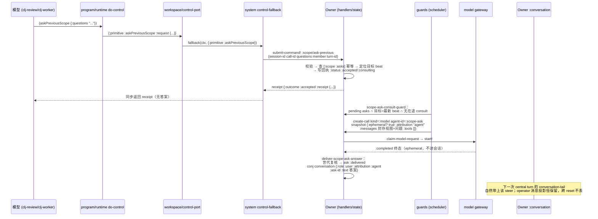
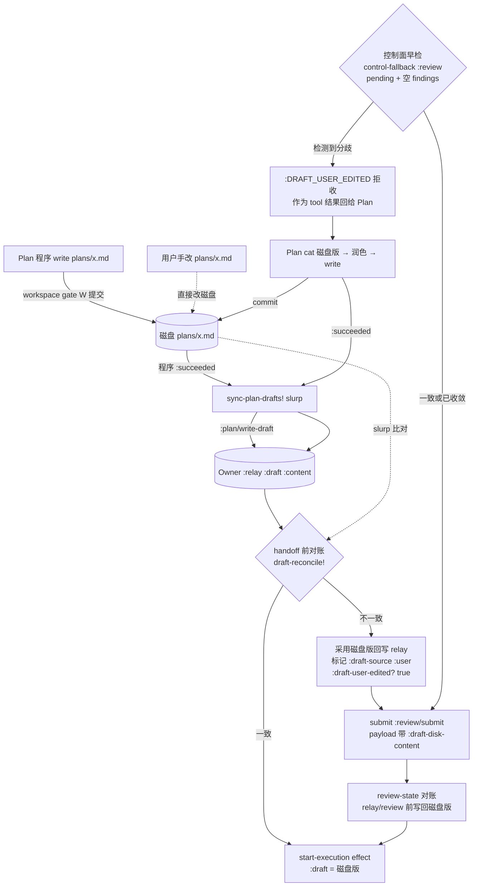

# 0.0.2 S2 设计：功能缺口 D-01 / D-03

- 日期：2026-11-07
- 范围：两条 L 级功能缺口的最小实现骨架。本文只做设计，不改 `src/`、`test/`。
- 上游依据：根 `AGENTS.md` §4.1（能力面板）、§6.2（Scope 与 Pair Hint）；`机制提炼/AGENTS.md` §6「历史回查向上一 Scope 提问」（封存视图 + 摘要 + 回执幂等 + 世代失效丢弃）与 §2.3（用户可编辑底稿，Plan 读取用户改动并润色，stamp 冲突以用户版本为准）；`plans/scope-cross-directory.md`（D-01 的既有接线清单，本设计在其上收敛）；`plans/debt-status-0.0.1.md` D-01/D-03 行。

## 0. 结论速览

| 缺口 | 根因（一句话） | 最小骨架 | 工作量 | 最大风险 |
|---|---|---|---|---|
| D-01 `askPreviousScope`/`negotiate` 只有账本快照 | 豁免成员已注册、scope 包已暴露 `snapshot`/`previous-scopes`，但 control 层没有 handler：receipt、持久化、封存视图咨询、steer 四层全缺 | Owner 新增 `:scope/asks` 回执表 + `:scope/ask-previous` 命令；guards 新增一次性 ephemeral consult model call；答案以 `role:"user"`/`attribution:"agent"` 追加会话；`negotiate` 由 `control-fallback` 直读 Owner book | **L** | ephemeral consult 复用 model-call 管线的边界（pair-hint 记账、claim 守卫、terminal 路由）容易做错；做成"普通用户回合"会污染 Scope 结算与前缀链 |
| D-03 用户编辑底稿后无润色与回读 | `set-draft`/`sync-plan-drafts!` 只在 Plan 程序成功后单向同步；`start-execution` 用 relay 内存 `:content`，从不读盘；handoff 后 draft 冻结，用户改动既不回读也无润色通道 | handoff 前在 Owner 命令层做一次"磁盘↔relay 对账"（`review-state` 在 `relay/review` 前 reconcile），不一致则采用磁盘版本并标记 `:draft-source :user`；Plan 侧靠既有 `cat`/`write` + `:FILE_CONFLICT`/`:DRAFT_USER_EDITED` 重试完成润色循环 | **M** | 对账点选错（放进纯函数 relay 层做不了 I/O；放进 control-fallback 会与 commit 之间留竞态窗口） |

---

## 1. D-01：`askPreviousScope` / `negotiate`

### 1.1 根因

链路四段，三段缺失：

1. **capability 已通**：`src/hc/server/program/capability.clj:16-36` 的 `:clj-review`/`:clj-worker` 已含 `:askPreviousScope :assume`；`:77` `program-functions`、`:93` `control-primitives` 已注册。`negotiate` 未注册（`capability.clj` 中不存在），spec 把它列为豁免成员但未定是否暴露为模型工具——`scope-cross-directory.md` §1 已给出决策点。
2. **scope 包只有读 seam**：`src/hc/core/scope/scope.clj:313-344` 的 `snapshot`/`previous-scopes`/`preceding-scope` 只读本地 reset 账本；包规格 §5 明确"不实现 receipt 重放与答案 steer"，属组合层职责。
3. **control 层是断头路**：`src/hc/compose/workspace.clj:252-272` `control-port` 对非 program-op primitive 走 `fallback`；`src/hc/server/app/system.clj:1196-1231` `control-fallback` 只处理 `:devops` 与 `:review`，其余一律 `:UNSUPPORTED_OPERATION`。`do-control`（`src/hc/server/program/runtime.clj:1136-1158`）把 primitive 原样交给 `:execute!`。
4. **Owner 没有承载**：`src/hc/compose/owner/state.clj:187` 的 `:scope` 只有 `{:book :records}`；无 asks 回执、无封存视图、无咨询通道。`scope-admission-check`（`state.clj:1032-1038`）直接透传 `scope-admission/check`，不知道"第二次 reset 前必须先 ask"这条准入规则（包规格 §5 明确该规则归 relay/组合层）。

### 1.2 语义钉死（先于实现）

按根 §6.2 与 `机制提炼/AGENTS.md` §6 收敛，以下几处必须先定死，否则实现会走偏：

- **目标 Scope**：`askPreviousScope` 的发起者是"后任闭环"（刚 reset 完或即将 reset 的模型），目标是"紧邻前一个 Scope"= **最近一个已结算 reset beat 所开启的那个 Scope**，即 `(last (scope-ledger/reset-beats book))`。`preceding-scope`（倒数第二个 beat）只用于"已在新 Scope 内、要再问更前一个"的二级场景，**不是**第二次 reset 前 ask 的目标。`reset-beats` 为空 → `:NO_PREVIOUS_SCOPE`。
- **ask 先、reset 后**：第二次及以后 reset 前必须已有针对当前 beat 的 ask 回执；ask 与 reset 不同调用（scope 包 exempt 短路已保证同调用不解析注解）。
- **receipt 三层**：受理（同步返回）→ 提问事实（持久化，`[call-id questions]` 幂等）→ 送达（封存视图咨询产出答案后，以 `role:"user"`、`attribution:"agent"` 的 steer 进会话）。答案**不在**同步返回值里。
- **封存视图**：Owner `:conversation` 永不裁剪，封存视图可纯函数重建——取"目标 beat 的 call-id 在会话中的位置"到"下一个 reset beat 的 call-id 位置（或会话尾）"之间的全部消息，`conversation->items` → `items->messages`。这比出站投影更全（含被裁掉的旧拍），正是"上一 Scope 只提供封存视图"的语义。摘要/世代键 = 目标 beat 的 `call-id`。
- **世代失效丢弃**：咨询发出后若又结算了更新的 reset（目标 beat 不再是最新），答案丢弃、不投递；回执停在 `:consulting`/`:accepted`，不标 `:delivered`。
- **不扣 retention**：`askPreviousScope`/`negotiate` 已是 `default-exempt-members`（`errors.clj:39`），`settle!` 返回 `:outcome :exempt` 不写记录；本设计不动 scope 包。
- **`negotiate` 暴露决策**：spec 把 `negotiate` 列为豁免工具且 `scope/snapshot` 已存在 → **推荐注册为 `:clj-review`/`:clj-worker` capability**（与 `scope-cross-directory.md` §1 一致），同步返回 book 快照，不提问、不写回执。

### 1.3 数据流



`negotiate` 是同图的短路：`CF` 直接 `((:snapshot owner))` 读 `[:state :scope :book]`，用 `scope-ledger` 函数拼出 `goal/budget/remaining/established?/must-reset/spin/resets/notice`，**不进 Owner 命令**（纯读）。

### 1.4 最小实现骨架

#### 1.4.1 新增/修改函数与字段

**`src/hc/compose/owner/state.clj`**

- `initial-state`：`:scope` 增加 `:asks {}`（`call-id → receipt`，随 Owner CAS 持久化）。
- 新增 `ask-target-beat`：`(peek (scope-ledger/reset-beats (scope-book state)))`；空 → nil。
- 新增 `sealed-scope-view`：输入 state + 目标 beat call-id；在 `:conversation` 中定位目标 beat 的 reset `:tool-call` 位置与下一 reset 的位置，切片 → `scope-runtime/conversation->items` → `scope-runtime/items->messages`。返回 `{:ok? true :messages [...] :digest <sha256>}` 或拒收。
- 新增 `ask-previous-scope-state`（纯函数，供 handlers 调）：
  - 入参 `{:call-id :questions :member :turn-id :agent-id :tenure-id :lane}`；
  - `questions` 非空白字符串否则 `:ASK_QUESTIONS_REQUIRED`；
  - 目标 beat nil → `:NO_PREVIOUS_SCOPE`；
  - `[:scope :asks call-id]` 已存在：questions 摘要相同 → 原样返回 receipt（幂等重放）；不同 → `:ASK_REPLAY_MISMATCH`；
  - 写入 `{:status :accepted :target-call-id … :questions-digest … :consult :pending :generation <最新beat call-id> :role/:tenure-id/:agent-id :at}`，outcome `:accepted`；
  - **不**创建 model call（consult 由 guard 触发，保持命令纯）。
- `scope-admission-check` 改签名收 `{:member :annotation :call-id}`：`(= :reset-scope (:kind annotation))` 且 `established?` 且 beats 非空 且 `(not (contains? (:asks (:scope state)) (:call-id (peek beats))))` → `{:ok false :code :SCOPE_ASK_REQUIRED :phase :admission :details {:previous-scope-call-id …}}`；其余透传 `scope-admission/check`。调用点 `handlers.clj:2079` 传入 `tool-call-id`。
- `message->scope-item`：`:user` 分支 payload 增加 `(contains? message :attribution) (assoc :attribution …)`；`scope-item->message` `:message` 分支同样透传（审计用，wire 由 `model-message-keys` 白名单裁掉，不外泄）。

**`src/hc/compose/owner/handlers.clj`**

- `command-kinds` 加 `:scope/ask-previous`、`:scope/ask-answer`。
- 新增 `apply-scope-ask-previous`：调 `state/ask-previous-scope-state`，`mission-result` 不需要（不动 mission），直接 `accepted/refused`；payload 取 `session-id/call-id/questions/member/turn-id/tenure-id/lane/agent-id`。
- 新增 `apply-scope-ask-answer`（供宿主注入答案的旁路，consult 失败时的人工/宿主通道）：校验 ask 存在且未 delivered、世代匹配 → 复用 `deliver-scope-ask-answer` 逻辑。
- `deliver-scope-ask-answer`（private）：世代复核（`(:generation ask) = 最新 beat call-id`）→ ask 置 `:delivered`/`:stale` → `conj :conversation {:role :user :text answer :attribution :agent :ask-id call-id :source :ask-previous-scope :at now}`；**不** conj `:pending-turns`（steer 是上下文注入，不是新指令；下一次自然回合携带）。可选 outbox `{:type :scope/ask-answered}` 供 UI 提示。
- `apply-model-event` 的 `:completed` 分支：call 带 `:scope-consult-for` 时不走 `finish-run`/assistant 消息路径，改走 `deliver-scope-ask-answer`（或先记 run 再投递——取最小：consult call 的 run 不进 `:conversation`，其 `:text` 直接作为答案）。consult call 需在 `create-call` 时打 `:scope-consult-for <ask-call-id>` 标记。
- dispatch 表（`:1466` 起）注册两个新 kind。

**`src/hc/compose/owner/guards.clj`**

- 新增 `scope-ask-consult-guard`（scheduler/guard，`:p3-progress` 档）：
  - 选取 `[:scope :asks]` 中 `:consult :pending` 且 `:generation` = 最新 beat call-id 且无同 ask 在途 consult call 的项；
  - `state/sealed-scope-view` 取封存消息，追加 `{:role :user :text (str "上一 Scope 的封存上下文中，请回答以下问题：\n" questions)}`；
  - `state/create-call {:kind :model :role :main :agent-id (str "scope-ask:" call-id) :request {:snapshot (merge (session-model-identity state) {:messages … :role :main :ephemeral? true :attribution "agent" :tools [] :scope-consult-for call-id}) :required-capabilities #{}}}`；
  - ask 置 `:consult :consulting`；
  - 世代不匹配的 pending ask 直接置 `:stale`（不发起 consult）。
- consult call 的 `agent-id` 唯一，`live-call-for-agent?` 不会误伤真实 agent；`:ephemeral? true` + `:attribution "agent"` 使 `pair_hint/integration.clj:47-52` 判为侧回合——注入但不记账、不动链位点，正是 spec 的形状。
- `catalog`（`guards.clj:2539`）的 `:p3-progress` 列表追加 `scope-ask-consult-guard`。

**`src/hc/server/app/system.clj`**

- `control-fallback` 增加第三参 `ask-scope-ref`（或直接复用 `owner-ref`）：
  - `:negotiate`：`@owner-ref` → `(:snapshot owner)` → `[:state :scope :book]`，用 `hc.core.scope.ledger` 拼快照（形状同 `scope/snapshot`：`goal/budget/remaining/established?/must-reset/spin/resets/notice`，`notice` 用 `hc.core.scope.records/cold-start-notice`）；owner 未起 → `:OWNER_NOT_READY`。
  - `:askPreviousScope`：校验 `(:questions request)` 非空 → `submit-owner-command!` `{:kind :scope/ask-previous :call-id (or (:call-id ctx) (:call-id request)) :questions … :member (or (:member ctx) …) :turn-id … :tenure-id (:tenure-id ctx) :lane (:lane ctx) :agent-id (:agent-id ctx)}`；receipt 原样返回；`submit!` 异常/超时 → `:ASK_PREVIOUS_SCOPE_FAILED`。
- 两处 `control-fallback` 调用点（`:1532`、`:1574`）与 `workspace/control-port` 调用同步；ns 增加 `[hc.core.scope.ledger :as scope-ledger]`、`[hc.core.scope.records :as scope-records]`。
- `control-fallback` docstring 更新：`negotiate`/`askPreviousScope` 归属、答案不在返回值。

**`src/hc/server/program/capability.clj`**（若采纳 negotiate 注册）

- `:clj-review`/`:clj-worker` `:capabilities` 加 `:negotiate`；`program-functions` 加 `negotiate :negotiate`；`control-primitives` 加 `:negotiate`。`:clj-plan`/`:dedicated-worker` 不加。同步改 `test/hc/server/program/capability_test.clj` 精确集合。

**`src/hc/compose/workspace.clj`**：`control-port` docstring 补一句 `:askPreviousScope`/`:negotiate`/`:assume` 由 fallback 归属；无逻辑改动。

#### 1.4.2 封存视图 / 摘要 / 回执 / 世代失效（字段清单）

```clojure
;; [:scope :asks <call-id>]
{:status :accepted | :consulting | :delivered | :stale | :failed
 :target-call-id "<最新 reset beat call-id>"
 :generation "<发起时最新 beat call-id>"   ; 世代键
 :questions "..." :questions-digest "<sha256>"
 :consult {:view-digest "<sha256>" :view-items <n> :call-id <consult call-id>}
 :answer {:text "..." :at <ms>}            ; delivered 后填
 :role :reviewer|:worker :tenure-id "..." :agent-id "..." :lane :execution
 :at <ms>}
```

- **摘要**：`questions-digest` 用于同 call-id 重放判定；`view-digest` 记录封存视图指纹（诊断/对账用，不参与判定）。
- **世代失效**：guard 选取与 `deliver-scope-ask-answer` 各复核一次 `(:generation ask) = (call-id (peek reset-beats))`；不等则 `:stale`，丢弃咨询结果/不投递。
- **回执幂等**：键 = ask 的 `call-id`（物理调用 id，Owner 内唯一）；同 id 同 digest 重放返回原 receipt，不重复 consult、不重复 steer。

### 1.5 需要改的文件

| 文件 | 改动 |
|---|---|
| `src/hc/compose/owner/state.clj` | `:scope :asks`、4 个新函数、`scope-admission-check` 签名与 ask 门、`message->scope-item`/`scope-item->message` attribution 透传 |
| `src/hc/compose/owner/handlers.clj` | `command-kinds`、2 个 apply 函数、`deliver-scope-ask-answer`、dispatch 表、`apply-model-event` consult 分支、admission 调用点传 call-id |
| `src/hc/compose/owner/guards.clj` | `scope-ask-consult-guard` + 注册 |
| `src/hc/server/app/system.clj` | `control-fallback` 两分支 + 两处调用点 + requires |
| `src/hc/server/program/capability.clj` | negotiate 注册（若采纳） |
| `src/hc/compose/workspace.clj` | 仅 docstring |
| `test/hc/server/app/control_port_test.clj` | fallback 三分支测试 |
| `test/hc/compose/owner/scope_state_test.clj`（或新 `scope_ask_test.clj`） | ask 门、回执幂等、世代失效、steer 形状 |
| `test/hc/compose/owner/guards_*_test.clj` | consult guard 选取/世代 |
| `test/hc/server/program/capability_test.clj` | negotiate 集合断言 |

### 1.6 测试断言

- `ask-previous-scope-returns-accepted-receipt-without-answer`：fake owner 命令返回 receipt；断言 `:outcome :accepted`、返回值无 `:answer`/`:text` 字段携带答案。
- `ask-previous-scope-replay-is-idempotent`：同 `[call-id questions]` 两次 → 同一 receipt、asks 表一条、consult call 只建一个。
- `ask-previous-scope-same-id-different-questions-refused`：`:ASK_REPLAY_MISMATCH`。
- `ask-previous-scope-without-beat-is-no-previous-scope`：空 book → `:NO_PREVIOUS_SCOPE`。
- `second-reset-without-ask-receipt-is-refused`：book 已有 1 个 reset、asks 空 → reset 注解 admission `:SCOPE_ASK_REQUIRED`；写入对应 beat call-id 的 ask 回执后通过。
- `first-reset-needs-no-ask`：冷启/空 book 的第一次 reset 不被 ask 门拦（`established? false` 放行）。
- `ask-and-reset-in-one-call-does-not-settle`：askPreviousScope 带 reset 注解走 exempt，不产生 scope 记录。
- `consult-answer-arrives-as-user-attribution-agent`：完成 consult 后 conversation 末尾为 `{:role :user :attribution :agent :ask-id …}`；`message->scope-item` 后投影跨一次 reset 仍保留（operator-message 保留规则）。
- `consult-answer-after-newer-reset-is-discarded`：consult 在途期间再结算 reset → 答案丢弃、ask `:stale`、无 conversation 追加。
- `consult-is-ephemeral-for-pair-hint`：snapshot `:ephemeral? true`/`:attribution "agent"` → `pair_hint` 不产生 placement/记账。
- `negotiate-returns-owner-book-snapshot`：goal/budget/remaining/spin/resets/must-reset 与 book 一致；冷启 book `must-reset true` + notice；owner 未起 `:OWNER_NOT_READY`。
- `negotiate-capability-registration`（若注册）：reviewer/worker 含 `:negotiate`，plan/dedicated-worker 不含。

### 1.7 工作量与依赖

- **工作量：L**。四层（handler/持久化/封存视图/ephemeral consult/steer/ask 门）跨 owner-state、handlers、guards、system 四个文件；consult 复用 model-call 管线是最大不确定面。
- **依赖**：无 scope 包改动；依赖 `pair_hint` ephemeral 判定（已存在）；依赖 Owner `:conversation` 全量保留（已成立）；`negotiate` 注册依赖 §1.2 决策。
- **可分期**：P1 = receipt+幂等+ask 门+`negotiate`（M）；P2 = 封存视图+consult+steer（L 的主体）。P1 落地后能力即"有回执无答案"，比现状 `:UNSUPPORTED_OPERATION` 已是实质推进；P2 未完成前 consult 可由 `:scope/ask-answer` 命令人工/宿主注入答案，保证端到端可测。

### 1.8 风险

1. **consult call 误入主链**：若 snapshot 漏 `:ephemeral?`/`:attribution "agent"`，pair-hint 会把它当普通回合记账并移动前缀链 → 前缀漂移误报。缓解：snapshot 构造集中在 guard 一处 + 专项测试。
2. **封存视图切片边界**：会话中 reset 的 `:tool-call`/`:tool` 对的位置决定切片；边界取错会把新 Scope 内容泄进旧视图或反之。缓解：以 call-id 定位而非位置猜测；`view-digest` 落回执便于对账。
3. **世代竞态**：consult 在途期间用户/模型又触发 reset → 答案过期。已按 spec 设计为丢弃；需确认丢弃不重试（spec：不自动重试）。
4. **steer 不触发回合**：答案只进 conversation 不产生 pending-turn，若新 Scope 此后无自然回合，答案滞留。spec 未要求强制唤醒；若评审认为需唤醒，加 outbox `:scope/ask-answered` 由宿主决定是否注入 pending-turn（列为开放决策）。
5. **`turn-tenure` 守卫**：consult call 的 tenure-id 记为发起时 tenure；若 consult 完成时 tenure 已 relay，`deliver` 仍写 conversation（conversation 是会话级，不受 tenure 守卫）——需确认这是期望行为（spec：答案属于会话上下文，应保留）。
6. **capability_test 精确集合**：注册 `:negotiate` 必须同步测试，否则全量红。

---

## 2. D-03：用户编辑底稿后无润色与回读

### 2.1 根因

1. **单向同步，无回读**：`src/hc/server/app/system.clj:1148-1190` `sync-plan-drafts!` 只在 `:plan` 角色程序 `:succeeded` 后把**磁盘文件** slurp 进 `:plan/write-draft` 命令——它是"程序写盘 → Owner"的单向泵。用户在两次 Plan 程序运行之间手改 `plans/<name>.md`，relay 的 `[:relay :draft :content]` 停留在上次同步值。
2. **handoff 用陈旧内容**：`src/hc/core/relay/core.clj:790-848` `start-execution` 的 effect `:draft (:content draft)` 取 relay 内存值；`src/hc/compose/mission/host.clj:2042-2055`（reopen 路径同）把它带进 `:execution/start`。整条链没有任何"handoff 前读盘对账"。
3. **冻结后无通道**：`relay/set-draft`（`core.clj:379-412`）在存在 execution tenure 后 `:DRAFT_LOCKED_AFTER_HANDOFF`；`check-draft-state`/`set-draft-state`（`host.clj:641-683,810-878`）同样拒绝。用户 handoff 后改文件，既不回读也无润色路径。
4. **`prepare.clj:835-844` 的 `:FILE_CONFLICT`** 是 stamp 复核的正常拒收（`cat` 采集 stamp → commit 时比对），不是缺陷本身；缺陷是**没人处理"用户版本为准"的重试语义**——Plan 收到 `:FILE_CONFLICT` 后没有被提示"重读磁盘版本再润色"的确定性路径（目前靠模型自觉）。

### 2.2 语义钉死

- **用户版本为准**：磁盘 `plans/<name>.md` 是唯一事实源；relay `:draft` 是其缓存。任何"relay ≠ 磁盘"都以磁盘为准回写 relay。
- **润色窗口 = handoff 前**：execution tenure 一建立 draft 即冻结，润色只能发生在 `start-execution` 生效之前。设计成"对账 → 若不一致先让 Plan 润色 → 再 handoff"的闭环，而不是 handoff 后补救。
- **润色载体 = 既有 Plan 能力**：`clj-plan` 已有 `cat`（读 draft-path）与 `write`（首评后解锁、execution tenure 前可写）。不需要新 capability；需要的是**确定性的发现机制**（系统检测到分歧并把 Plan 拉回一轮），而不是指望模型主动发现。
- **`FILE_CONFLICT` = 润色重试信号**：Plan `cat`→`write`→commit 之间用户再改 → stamp 不符 → `:FILE_CONFLICT`；Plan 收到后重 `cat` 重写即完成"以用户最新版为准"的覆盖。这是 spec §2.3 的既有语义，本文只补"为什么会发生 + 如何收敛"的说明，不改 workspace_gate。

### 2.3 数据流



两条检测点的分工：**控制面早检**（`control-fallback :review`，在提交 review 命令前）负责"不一致就拒收并让 Plan 润色"；**命令层对账**（`review-state` 在 `relay/review` 前）负责"即使早检被绕过（reopen、直接命令路径），handoff 载荷永远用磁盘最新"。早检是体验优化，对账是正确性兜底。

### 2.4 最小实现骨架

#### 2.4.1 新增/修改函数与字段

**`src/hc/core/relay/core.clj`**（保持纯函数，I/O 由调用方注入）

- `set-draft` receipt 增加 `:content-length`（已有）之外的 `:draft-version`：单调递增整数，存于 `[:draft :version]`；`new-state` 初始 `:draft nil` 不变。用途：对账与诊断，不参与判定（判定用内容比较）。
- `start-execution`：draft 校验通过后，effect 增加 `:draft-source`（`:program` 默认 / 调用方可传 `:user`）与 receipt 增加 `:draft-user-edited?`；不改语义，只透传标记。`new-state`/`set-draft` 签名不变。

**`src/hc/compose/mission/host.clj`**

- 新增 `draft-reconcile-state`（纯函数）：入参 `state` + `{:path :disk-content}`（调用方已读盘）；比较 `(get-in state [:relay :draft :content])` 与 `disk-content`：
  - 相同 → 原样 state + `{:changed? false}`；
  - 不同 → `(assoc-in state [:relay :draft :content] disk-content)` + `[:relay :draft :source] :user` + `[:relay :draft :user-edited?] true` + `[:relay :draft :version] (inc …)`，返回 `{:changed? true :previous-length … :disk-length …}`。
  - `disk-content` 为 nil（文件缺失）→ 不改 state，返回 `{:changed? false :missing? true}`（缺失交给既有 `:DRAFT_MISSING_OR_EMPTY`/文件层处理，不在此发明新语义）。
- `review-state`：在调 `relay/review` **之前**执行对账——`(draft-reconcile-state state {:disk-content (:draft-disk-content command)})` 得到 `state*`，后续 `relay/review`/`apply-effects`/`assoc-in [:bindings :plan :reviewed-in-tenure?]` 全部用 `state*`。这样 `:execution/start` effect 的 `:draft`（由 `relay/start-execution` 从 `[:relay :draft]` 读取）自动携带磁盘最新内容，**不需要**在 `apply-effect` 里再钩。`reopen-state` 暂不接（见 §2.7 已知边界）。

**`src/hc/server/app/system.clj`**

- 新增 `draft-disk-read` helper：`(slurp (java.io.File. root draft-path) "UTF-8")`，文件不存在/读失败返回 nil（带 diagnostic，不抛）。
- `control-fallback :review` 分支前置早检：当 `(:lane ctx)` 为 plan 侧且 owner snapshot 显示 plan milestone `:pending` 且 `(:findings request)` 为空时，读盘比对 `[:state :mission :relay :draft]`：
  - 一致 → 正常走 `submit-owner-command! :review/submit`；
  - 不一致 → **不提交 review**，直接返回 `{:ok? false :error {:code :DRAFT_USER_EDITED :message "底稿已被用户修改；请先 cat 该文件、润色后 write，再重新 review" :details {:path … :disk-length … :relay-length …}}}`。该拒收作为 program 的 control 结果回给模型，Plan 下一步自然 `cat`+`write`。
  - 读盘失败 → 放行（fail-open 到对账兜底，不阻塞 handoff）。
- `sync-plan-drafts!` 不变（它已是"磁盘→Owner"泵）。对账不放在 effect 应用点：`mission/apply-command` 内部执行 `apply-effects`，system 层拿不到中间态；正确位置是 **Owner 命令层**——调用方把 disk-content 放进 review command payload，`review-state` 在 `relay/review` 前完成对账（见上）。即：
  - `control-fallback :review` 总是附带 `:draft-disk-content`（读盘结果，可为 nil）；
  - `mission-control/review-command`（`src/hc/compose/mission/control.clj`）透传该字段；
  - `handlers.clj apply-review` → `mission/apply-command {:op :review … :draft-disk-content …}`；
  - `host.clj review-state` 在 `relay/review` 前对账（见上），对账结果进入同一 CAS 提交。
  - `reopen!` 路径：`host.clj reopen-state` 的 effect 构造读 `(:relay :draft)`；completed mission 的 operator 消息走 `:user/message` → `{:op :reopen}`，不经过 `control-fallback`，没有注入点。**最小化：reopen 路径不接对账**，靠主路径 + 下一次 Plan 同步收敛，列为已知边界（§2.7）。

**`src/hc/compose/mission/control.clj`**：`review-command` 增加 `:draft-disk-content` 透传（select-keys 或显式 assoc）。

**`src/hc/server/app/prompts.clj`**（plan-prompt）：`# Surface` 段补一句："The draft file may be edited by the operator at any time; `cat` before `write` when refining, and on `:FILE_CONFLICT` or `:DRAFT_USER_EDITED` re-read the file and rewrite the polished version."

**`src/hc/compose/owner/state.clj`**：`message->scope-item` 无需改；`[:relay :draft :source/:user-edited?]` 是 mission 状态，Owner snapshot 可见，无需新字段。

#### 2.4.2 磁盘回读 / diff / 润色 / handoff 重读（落点清单）

| 环节 | 落点 | 说明 |
|---|---|---|
| 磁盘回读 | `system.clj draft-disk-read` + `control-fallback :review` | handoff 前唯一一次权威读盘；失败 fail-open |
| diff | `host.clj draft-reconcile-state` | 纯字符串比较；产出 `:changed?` 与长度诊断 |
| 润色 | 既有 Plan `cat`/`write` + `:DRAFT_USER_EDITED` 拒收驱动 | 无新 capability；prompt 补一句触发语义 |
| handoff 重读 | `review-state` 在 `relay/review` 前的 reconcile | effect `:draft` 永远等于对账后（磁盘）版本 |
| stamp 冲突 | `prepare.clj check-one` 既有 `:FILE_CONFLICT` | 不改；作为润色重试信号写进 prompt |
| 封存/世代 | `[:relay :draft :version]` 单调递增 | 诊断用；relay 换任（barrier）后 draft 保留，version 延续 |

### 2.5 需要改的文件

| 文件 | 改动 |
|---|---|
| `src/hc/core/relay/core.clj` | `set-draft` receipt/`[:draft :version]`、`start-execution` effect `:draft-source`/receipt `:draft-user-edited?` |
| `src/hc/compose/mission/host.clj` | `draft-reconcile-state`、`review-state` 在 `relay/review` 前对账并透传 `:draft-disk-content` |
| `src/hc/compose/mission/control.clj` | `review-command` 透传字段 |
| `src/hc/compose/owner/handlers.clj` | `apply-review` 透传 `:draft-disk-content` 进 mission command |
| `src/hc/server/app/system.clj` | `draft-disk-read`、`control-fallback :review` 早检 + 注入 |
| `src/hc/server/app/prompts.clj` | plan-prompt 一句用户编辑/冲突语义 |
| `test/hc/core/relay/*` 或 `test/hc/compose/mission/*` | reconcile 纯函数测试 |
| `test/hc/server/app/control_port_test.clj` | 早检拒收/放行 |
| `test/hc/compose/mission/host_test.clj`（或 control_test） | effect 注入后 `:draft` 为磁盘版 |

### 2.6 测试断言

- `draft-reconcile-adopts-disk-content`：relay content ≠ disk → state draft 变磁盘版、`:source :user`、`:user-edited? true`、version+1。
- `draft-reconcile-identical-is-noop`：相同 → `:changed? false`，version 不变。
- `draft-reconcile-missing-file-keeps-relay`：disk nil → state 不变、`:missing? true`。
- `execution-start-effect-carries-disk-draft`：注入 `:draft-disk-content` 不一致 → `:execution/start` effect `:draft` = 磁盘版、receipt `:draft-user-edited? true`、`:draft-source :user`。
- `review-early-check-refuses-on-divergence`：pending milestone + 空 findings + 磁盘≠relay → control 返回 `:DRAFT_USER_EDITED`，**没有** `:review/submit` 命令提交（fake owner 断言零调用）。
- `review-early-check-passes-when-aligned`：一致 → 正常提交；磁盘读取失败 → 放行提交。
- `polish-loop-converges`：端到端——分歧 → `:DRAFT_USER_EDITED` → 模拟 Plan `cat`+`write`（新内容）→ sync → 再 review → `:execution-started`，最终 relay draft = 磁盘版。
- `file-conflict-on-polish-write-retries`：`cat` 与 commit 之间磁盘再变 → commit `:FILE_CONFLICT`（既有断言）→ Plan 重 `cat` 重写成功（模拟第二轮）。
- `handoff-freeze-still-holds`：execution tenure 存在后 `set-draft`/`check-draft` 仍 `:DRAFT_LOCKED_AFTER_HANDOFF`（回归）。
- `draft-version-monotonic`：多次 set-draft/reconcile version 严格递增。

### 2.7 工作量与依赖

- **工作量：M**。三处小改（relay 字段、host reconcile、system 早检/注入）+ prompt 一句 + 测试；无新模块、无新持久化结构。
- **依赖**：`sync-plan-drafts!` 已是磁盘→Owner 泵（复用）；`prepare.clj` stamp 机制不动；`control-fallback` 已有 owner-ref/snapshot 访问。
- **已知边界**：reopen 路径（completed mission 的 operator 消息重开）暂不注入 disk-content，依赖下一次 Plan 同步收敛；handoff 后用户改动仍无润色通道（spec 的"Plan 读取用户改动并润色"在冻结语义下只能理解为 handoff 前窗口，本文按此实现；若 spec 要求 handoff 后也润色，需新增 execution 期 draft 写通道，属另一个 L 级决策）。

### 2.8 风险

1. **早检/对账竞态**：早检通过到 commit 之间用户再改 → handoff 用早检时的磁盘版（已是"当时最新"），effect 对账在 command 应用时再读一次可进一步收敛；剩余窗口是"读盘到 Owner CAS 提交"之间，无法完全消除——可接受，因为 swarm/Reviewer 通过 `draft-path` 读盘拿到的总是更新值，relay `:draft` 只是 effect 载荷与审计。
2. **`draft-disk-content` 透传链路长**：system → control.clj → handlers → host 四层透传，任一环节 select-keys 截断都会静默丢字段 → 对账失效退化为现状。缓解：端到端测试断言 effect `:draft` 内容，而非只测各层。
3. **Plan 被 `:DRAFT_USER_EDITED` 循环拒绝**：若用户持续改文件，Plan 可能反复 cat/write/撞冲突。spec 的无人值守语义下这是正确行为（等用户停手）；可加 diagnostics 计数防抖，但最小实现先不加，观察。
4. **`set-draft` version 与既有 receipt 兼容**：receipt 加字段对旧消费者安全（EDN map 加键）；`[:draft :version]` 持久化在 mission state，restore 校验需确认 `check-invariants` 不拒绝新键（`relay` 状态由 `relay/restore` 校验，需检查其字段白名单）。
5. **fail-open 读盘失败**：磁盘不可读时 handoff 用 relay 旧值——比拒绝 handoff 更可用，但应记 diagnostic 供排查。

---

## 3. 两条线的并行切分建议

- D-01 与 D-03 文件面几乎不相交：D-01 主战场 `owner/{state,handlers,guards}.clj` + `server/app/system.clj(control-fallback)`；D-03 主战场 `core/relay/core.clj` + `compose/mission/{host,control}.clj` + `server/app/system.clj(control-fallback :review 分支)` + `server/app/prompts.clj`。
- **唯一共享热点**：`system.clj` 的 `control-fallback`（D-01 加两个分支、D-03 改 `:review` 分支）与 `handlers.clj` dispatch 表（D-01 加两个 kind）。建议同一工人顺序做，或 D-03 先合（M 较小）再 D-01。
- scope 包、workspace_gate、prepare.clj、capability（除 negotiate 决策）均不需要改。
