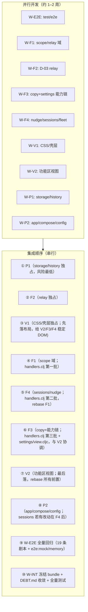

# 0.0.2 S2 并行分工与冲突面（plans/0.0.2-s2-parallel.md）

- 日期：2026-11-07
- 范围：0.0.2 四线并行（E2E 自动化、功能缺口 D-01/03/11/12/13/19/20、视觉 P0、性能）的文件所有权、冲突矩阵、集成顺序与共享资源分配。
- 约束：单仓库多 worker；只读调研 + 本文档，不改 `src/`、`test/`。
- 依据：根 `AGENTS.md`、`DEBT.md`（D-01/03/11/12/13/19/20/22/23 现状）、`plans/visual-audit-*.md`（六份视觉审查）、`plans/e2e-0.0.1-runbook.md`、`plans/memory-efficiency-0.0.1.md`、`plans/e2e-auto-defects.md`、`test/e2e/support/app.mjs`（端口 `--port 0`、独立 data-dir 已有约定）。
- 说明：各线 `plans/0.0.2-s2-*.md` 设计文档由对应 worker 并行产出；本文档在其落地前按 DEBT/审查报告/源码结构推定触碰面，worker 开工时须以各自 S2 文档为准并回写本文档的冲突矩阵。

## 1 四条线触碰面（推定）

### 1.1 E2E 自动化线（w132-s2-e2e）

| 文件/模块 | 用途 |
|---|---|
| `test/e2e/e2e-*.spec.mjs`（新增 19 条剧本） | 剧本自动化 |
| `test/e2e/support/{app,mock-model,mock-services,ui}.mjs` | 启动器/mock/UI 驱动扩展 |
| `test/e2e/playwright.config.mjs` | 可能加 project/grep 分组 |
| `package.json` scripts（`e2e:*`） | 可能新增分组脚本 |
| `plans/e2e-evidence/**`、`plans/e2e-*.md` | 证据与结论（只写 plans/） |
| `journeys/*.md` | 只读参照，不改 |

原则：E2E worker **不改产品代码**；发现的产品缺陷写入缺陷报告并路由给功能/视觉线（经 Main），避免与产品 worker 抢同一文件。若确需小修，必须先在 `plans/0.0.2-s2-parallel.md` 冲突矩阵登记并与 owner 协调。

### 1.2 功能缺口线（w133-s2-features，建议拆 4 个 worker）

| 缺口 | 主要文件 | 测试 |
|---|---|---|
| D-01 negotiate/askPreviousScope | `src/hc/core/scope/scope.clj`（`snapshot`/`previous-scopes`，:313-344）、`src/hc/compose/workspace.clj`（`control-port` :252-272） | `test/hc/core/scope/`、`test/hc/compose/` |
| D-20 scope annotation（nudge 轮 `:SCOPE_ANNOTATION_MISSING`） | `src/hc/compose/nudge/**`、`src/hc/core/scope/**`、`src/hc/compose/owner/handlers.clj`（nudge 轮构造处） | `test/hc/compose/nudge/`、scope 测试 |
| D-03 用户编辑底稿回读/润色 | `src/hc/core/relay/core.clj`（`set-draft` :379-412、`start-execution` :790-848）、`src/hc/core/workspace_gate/prepare.clj`（:835-844 `:FILE_CONFLICT`） | `test/hc/core/relay/`、`workspace_gate` |
| D-11 24→10 未交付理由 | `src/hc/client/copy/failures.cljc`、`test/hc/client/copy/failures_test.clj`、`test/hc/client/swarm/ui_test.cljs`、`test/hc/client/conversation/selection_dom_test.cljs`、`test/hc/client/conversation_test.clj` | 同左 + 可能的 UI 状态词断言 |
| D-12 手动模型 `:tools` 进 binding | `src/hc/client/settings/{connection,draft,model_binding}.cljc`、`src/hc/client/settings/view.cljc`（能力编辑器保存链）、`src/hc/compose/owner/handlers.clj`（`save-connection`/发送门禁 :120-160、:1429）、`src/hc/server/app/snapshot.clj`（`binding-availability` :480-495）、`src/hc/server/model_adapter/**` | `test/hc/client/settings/`、`test/hc/compose/owner/`、`test/hc/server/app/` |
| D-13 nudge 持续注入无 idle 边界 | `src/hc/compose/nudge/**`、`src/hc/compose/scheduler/**`、`src/hc/server/sessions/**`（run/等待态）、`src/hc/client/conversation/**`（状态显示） | `test/hc/compose/nudge/`、`test/hc/server/sessions/` |
| D-19 单 `:main` 配置 devops unknown role | `src/hc/compose/fleet/**`、`src/hc/compose/owner/handlers.clj`（角色投影）、`src/hc/server/model_adapter/**`（角色解析） | `test/hc/compose/fleet/`、owner 测试 |

### 1.3 视觉 P0 线（w134-s2-visual，建议拆 2 个 worker）

| 文件/模块 | 事项 |
|---|---|
| `resources/public/css/workbench.css`（2601 行，**全线最热点**） | R-05 字号 rem 锚定、R-19 color-scheme、R-20 safe-area、R-21 `100dvh`、R-23 抽屉互斥、820/1024 断点、看板/文件两栏断点、44px 触摸热区残留 |
| `resources/public/index.html` | R-06 首屏骨架/加载文案 |
| `src/hc/client/workbench/views/shell.cljs` | R-03/R-04 内部 token 中文化、R-24 `<aside>`→`<nav>`、抽屉状态 |
| `src/hc/client/workbench/views/session.cljs` | R-02 会话行时间戳本地化（:73） |
| `src/hc/client/conversation/**`（view/surface/composer） | B-03 无模型提示与入口、R-12 空态主操作、B10 阅读计数口径、消息状态词（与 D-11 联动） |
| `src/hc/client/settings/{view,appearance-adjacent}.cljc`、`src/hc/client/appearance/**` | B-02 三步向导、B-05 外观项、B-06 价格预览、U-01/U-06 标签层级（**与 D-12 冲突区**） |
| `src/hc/client/{schedule,backup,materials,miniapps,swarm,diagnostics,files,artifacts,browser}/**` | 各区域 ugly/P1 项（U-02~U-07、B-11~B-17、看板中文化） |
| `src/hc/client/copy/**` | 文案中文化（与 D-11 冲突区） |

### 1.4 性能线（w135-s2-perf，建议拆 2 个 worker）

| 文件/模块 | 事项 |
|---|---|
| `src/hc/server/storage/**`（engine、快照、读路径） | Datalevin 读放大、投影缓存、分页 |
| `src/hc/server/history/**`（run_port、snapshot、context） | `frozen-entries`/`input-snapshot` 成本、消息集拷贝 |
| `src/hc/server/sessions/**` | session doc 读写、`:runs` 投影 |
| `src/hc/server/blob_store/**`、`src/hc/server/app/snapshot.clj` | blob 读取、状态增量体积 |
| `src/hc/compose/**`（fleet/scheduler 重试/取消） | 轮询与重算热点 |
| `deps.edn`、`pixi.toml`、`scripts/**`、`test/e2e/support/memory` 相关 | JVM `-Xmx/-XX` 默认值固化、内存基准脚本 |
| `test/hc/server/**` 对应测试 | 性能回归断言 |

## 2 冲突矩阵

图例：🔴 同文件多线必改（需串行或按符号切分）；🟡 同目录/相邻文件高概率重叠；🟢 独占。

| 文件/模块 | E2E | 功能线 | 视觉线 | 性能线 | 冲突级别与处置 |
|---|---|---|---|---|---|
| `test/e2e/**` | ✅ | — | — | — | 🟢 E2E 独占；产品缺陷走报告路由 |
| `resources/public/css/workbench.css` | — | — | ✅ | — | 🟢 视觉独占；其他线不得改，视觉需求由 V1 统一落 |
| `resources/public/index.html` | — | — | ✅ | — | 🟢 视觉独占 |
| `src/hc/core/scope/**` | — | D-01+D-20 | — | — | 🔴 功能线内部 F1 独占；D-01 与 D-20 同属 scope 域，必须同一 worker |
| `src/hc/compose/workspace.clj` | — | D-01 | — | — | 🟡 与 `compose/owner/handlers.clj` 相邻；F1 只改 `control-port` 段 |
| `src/hc/core/relay/**`、`src/hc/core/workspace_gate/**` | — | D-03 | — | — | 🟢 F2 独占 |
| `src/hc/client/copy/failures.cljc` | — | D-11 | 文案中文化可能触碰 | — | 🔴 功能 F3 与视觉 V2 分工：failures.cljc 归 F3；其他 copy 文件归 V2；`failures_test.clj` 归 F3 |
| `src/hc/client/settings/**` | — | D-12 | B-02/B-05/B-06/U-01/U-06 | — | 🔴 **最大热点**。按文件切分：D-12 归 `connection.cljc`/`draft.cljc`/能力保存链与 `view.cljc` 中能力编辑器段；视觉归向导布局、外观、价格预览段。`view.cljc`（1207 行）两线都要改 → 建议 V2 先合入布局骨架，F3 后合能力链；或 F3 把能力编辑抽到新文件 `capability_editor.cljc` 由 F3 独占 |
| `src/hc/compose/owner/handlers.clj`（2870 行） | — | D-12/D-13/D-19/D-20 | — | — | 🔴 **第二热点**。四个缺口都可能落在此文件。处置：按命令 handler 函数切分所有权（见 §3），禁止整文件级并行编辑；合并按 F1→F2→F3→F4 顺序 |
| `src/hc/compose/nudge/**`、`scheduler/**` | — | D-13/D-20 | — | 重算热点 | 🟡 功能 F4 与性能 P2 相邻；P2 只做测量与明显低效改写，不改语义 |
| `src/hc/server/sessions/**` | — | D-13（run 边界） | — | session doc 读写优化 | 🔴 F4 与 P1 同文件风险。处置：P1 只碰 `storage/engine` 与 `history/**`；sessions 归 F4，性能侧若需改 sessions 先协调 |
| `src/hc/server/history/**`、`storage/**` | E2E05 依赖其正确性 | — | — | ✅ | 🟢 性能 P1 独占；功能线不改（D-17/D-22/D-23 已关闭） |
| `src/hc/client/conversation/**` | E2E 断言依赖 | D-13（idle/状态显示）、D-11（状态词） | B-03/R-12/B10/状态词 | — | 🔴 功能 F3/F4 与视觉 V2 三方重叠。处置：`copy`/状态词映射归 F3，idle 边界 UI 归 F4，空态/提示/布局归 V2；`view.cljs`（2786 行）按区段切分，先 V2 后功能线 |
| `src/hc/client/workbench/views/**` | — | — | ✅ | — | 🟢 视觉独占（shell/session/settings/board 等） |
| `src/hc/client/{schedule,backup,materials,miniapps,swarm,diagnostics,files,artifacts,browser}/**` | — | — | ✅ | — | 🟢 视觉独占；`swarm/ui.cljs` 的英文断言联动测试归 V2 |
| `src/hc/client/settings/view.cljc` 与 `conversation/view.cljs` 内联 CSS | — | D-12 可能 | ✅ 视觉主改 | — | 🔴 内联样式集中在这两个大文件；视觉改视觉，功能改逻辑，按 DOM 区段切分 |
| `src/hc/server/app/snapshot.clj` | — | D-12（binding-availability） | — | 快照体积优化 | 🟡 F3 改 `binding-availability`/能力字段；P2 若优化快照结构须在 F3 合并后进行 |
| `src/hc/server/model_adapter/**` | — | D-12/D-19 | — | — | 🟡 归功能线（F3/D-12 能力解析、F4/D-19 角色回退），两 worker 不同时改同一 provider 文件 |
| `deps.edn`/`pixi.toml`/`scripts/**` | — | — | — | ✅ | 🟢 性能 P2 独占；其他线不得加依赖 |
| `DEBT.md` | — | 各缺口关闭时删条 | — | — | 🟡 只由集成者（Main）统一更新，worker 不直接改 |
| `package.json`/`package-lock.json` | E2E 可能加 script | — | — | — | 🟡 E2E 独占 scripts 段；其他线不动 |
| `resources/public/js/main.js`（构建产物） | — | — | — | — | 🔴 **共享构建输出**，见 §4 构建锁 |

## 3 并行分工方案（建议 10 个 worker）

### 3.1 分工表

| Worker | 线 | 职责 | 文件所有权（独占） | 验收 |
|---|---|---|---|---|
| W-E2E | E2E | 剩余 19 条剧本 spec + mock 扩展 + 证据 | `test/e2e/**`、`package.json` scripts | 每条剧本 PASS/FAIL/BLOCKED 证据；产品缺陷报告 |
| W-F1 | 功能 | D-01 negotiate + D-20 scope annotation | `src/hc/core/scope/**`、`src/hc/compose/workspace.clj`、`src/hc/compose/nudge/**`（annotation 段）、对应 test | negotiate 回执幂等 + steer；nudge 轮不再 `:SCOPE_ANNOTATION_MISSING` |
| W-F2 | 功能 | D-03 底稿回读/润色 | `src/hc/core/relay/**`、`src/hc/core/workspace_gate/**`、对应 test | 用户改稿后 Plan 读到磁盘版本并润色；handoff 用磁盘最新 |
| W-F3 | 功能 | D-11 十类理由 + D-12 工具能力链 | `src/hc/client/copy/failures.cljc`、`src/hc/client/settings/{connection,draft}.cljc`、能力编辑相关、`src/hc/compose/owner/handlers.clj`（save-connection/发送门禁段）、`src/hc/server/app/snapshot.clj`（binding 段）、`src/hc/server/model_adapter/**`（能力解析段）、对应 test | 声明 tools 后 Plan 可发送（E2E01 前置）；24→10 映射与三态断言 |
| W-F4 | 功能 | D-13 idle 边界 + D-19 角色回退 | `src/hc/compose/nudge/**`（idle/账本边界段，与 F1 的 annotation 段按函数切分）、`src/hc/compose/scheduler/**`、`src/hc/compose/fleet/**`、`src/hc/server/sessions/**`、`src/hc/server/model_adapter/**`（角色解析段）、`src/hc/client/conversation/**`（状态显示段）、对应 test | 可观察轮次边界；单 `:main` 配置 devops 可运行 |
| W-V1 | 视觉 | 全局 CSS/骨架/响应式（R-02~R-24 中 CSS/壳层项） | `resources/public/css/workbench.css`、`resources/public/index.html`、`src/hc/client/workbench/views/{shell,session}.cljs`、`src/hc/client/appearance/**`、相关 test | 360/820/1024/1280 × 浅深 × 80–200% 字号截图矩阵无横向溢出/裁切 |
| W-V2 | 视觉 | 各功能区 ugly/P1 + 文案（B-01~B-17、U-01~U-07、看板中文化） | `src/hc/client/{schedule,backup,materials,miniapps,swarm,diagnostics,files,artifacts,browser}/**`、`src/hc/client/settings/view.cljc`（非能力段）、`src/hc/client/conversation/**`（空态/提示/布局段，与 F3/F4 按区段切分）、`src/hc/client/copy/**`（failures.cljc 除外） | 各审查报告"未修"清单逐项关闭或明确降级 |
| W-P1 | 性能 | 存储/历史/会话读路径 | `src/hc/server/storage/**`、`src/hc/server/history/**`、`src/hc/server/blob_store/**`、对应 test | 分配/耗时基准对比（沿用 `plans/memory-efficiency-0.0.1.md` 方法） |
| W-P2 | 性能 | 应用层快照/组合层 + JVM/构建配置 | `src/hc/server/app/**`（snapshot 除 binding 段）、`src/hc/server/sessions/**`（仅在与 F4 协调后）、`src/hc/compose/**`（非 F1/F4 段）、`deps.edn`、`pixi.toml`、`scripts/**`、内存基准脚本 | `-Xmx` 显式化、快照增量体积、compose 重算热点；不改产品语义 |
| W-INT | 集成 | 冲突仲裁、bundle 重建、DEBT.md 更新、最终回归 | `DEBT.md`、plans 汇总、`resources/public/js/main.js` 构建 | 见 §5 |

### 3.2 关键切分约定（避免 🔴 冲突）

1. **`handlers.clj`（2870 行）**：按顶层 defn/命令分派切给 F1（workspace control）、F3（model/save/send 门禁）、F4（nudge/scheduler 触发）。同一函数被两线需要时，先合入方保留函数签名，后合方在其上扩展；禁止双方同时重写同一函数。
2. **`settings/view.cljc`**：F3 只动能力编辑器与保存载荷相关 sexp；V2 只动布局/向导/外观/价格 DOM。两线在同一 render 函数内交错时，以"先到先合、后到 rebase"为准，W-INT 仲裁。
3. **`conversation/**`**：F3 管 `copy`/状态词数据源；F4 管 idle/轮次边界状态机；V2 管空态、提示文案、布局 CSS。`view.cljs` 按 banner/composer/message-list 区段归属。
4. **`compose/nudge/**`**：F1 管 scope annotation 生成；F4 管账本清空/idle 边界。同目录不同文件优先；同文件按函数切分。
5. **`sessions/**`**：默认归 F4；P2 如需改，必须先经 W-INT 协调，且只在 F4 合并后进行（见 §5 串行点）。
6. **测试文件**：每个 worker 只改自己缺口对应的 `test/hc/**` 命名空间；`failures_test.clj` 等被 D-11 点名的旧断言归 F3。

## 4 共享资源分配

| 资源 | 约定 |
|---|---|
| 端口 | 已有约定：app 一律 `--port 0`（`test/e2e/support/app.mjs:170`、runbook §1）；禁止固定端口并行实例 |
| data-dir / workspace | 每个 app 实例独立 `mktemp -d`（`/tmp/hc-<worker>-<run>/data`），互不共享；E2E 与手工复现同规则 |
| Chrome / Playwright | 每 worker 独立 browser context；系统 Chrome `/usr/bin/google-chrome` + `NODE_PATH=/tmp/hc-pw/node_modules`；建议 `--workers=2` 限制并发浏览器数（内存约束，参考 memory-efficiency §1.1：Chrome 曾达 7 GiB RSS） |
| JVM 内存 | 所有 `clojure -M` 调用带 `JAVA_TOOL_OPTIONS=-Xmx1g -XX:MaxDirectMemorySize=512m`（沿用 W13 全量测试口径）；严禁依赖 16.7 GiB 人体工学默认堆 |
| 构建锁 | `resources/public/js/main.js` 是唯一 bundle 输出且是发布身份（sha256 冻结）。**任何 worker 验证 UI 前必须 `flock /tmp/hc-build.lock` 包住 `npm run release`（或 shadow-cljs release）**；bundle 重建后记录 sha256 到 `plans/0.0.2-s2-builds.md`。最终冻结 bundle 只由 W-INT 重建一次 |
| 全量测试 | `clojure -M:test` 全量（约 380 s）只由 W-INT 在集成点运行；worker 只跑自己命名空间的定向测试，降低 CPU/内存风暴 |
| Datalevin store | 每实例独立 data-dir 天然隔离；禁止共享 `/tmp` 下固定 store 路径 |
| DEBT.md / plans | DEBT.md 只由 W-INT 更新；worker 把"可关闭条目"写进各自 S2 报告 |

## 5 集成顺序

原则：**先合无冲突独占区 → 再合热点文件 → 最后 E2E 全量回归**。每次合入后 W-INT 重建 bundle 并记录 sha。

必须串行的点：

1. `handlers.clj` 三个功能 worker（F1→F4→F3）按序合入，后者 rebase。
2. `settings/view.cljc` 与 `conversation/view.cljs`：V1 先合 CSS/壳层 → V2 与 F3/F4 在功能合入前协调区段 → 功能线先合逻辑、V2 最后合视图（避免视图重写冲掉逻辑改动）。
3. `sessions/**`：F4 先合；P2 的 sessions 改动排在 F4 之后。
4. `model_adapter/**`：F3（能力）与 F4（角色）按 provider 文件切分；同文件时 F3 先合。
5. E2E 全量回归必须在所有产品改动合入、bundle 冻结之后；E2E worker 在此之前只跑 mock/已存在 spec 的开发循环。

## 6 风险

| 风险 | 等级 | 缓解 |
|---|---|---|
| `handlers.clj`/`view.cljc`/`view.cljs` 三文件多方编辑产生语义冲突 | 高 | §3.2 函数/区段级所有权 + 串行合入顺序 + W-INT 仲裁 |
| D-12 与视觉 B-02 向导同改 `settings/view.cljc` | 高 | 能力编辑器抽离为独立 namespace 归 F3；向导布局归 V2 |
| D-11 状态词与 V2 文案中文化口径不一致 | 中 | 先定"24→10 映射 + 三态"为唯一事实源（F3），V2 只消费不另立口径 |
| bundle sha 频繁变化使 E2E 证据失效 | 中 | 构建锁 + 只在集成点重建；E2E 证据记录当时 sha，回归时统一复跑 |
| 并发过高触发 memfuckilld/Chrome OOM（0.0.1 已发生） | 高 | §4 JVM/Chrome 限额；建议并发 worker ≤10，Playwright `--workers=2`；全量测试仅 W-INT 一次 |
| 性能改动与功能改动在 `sessions`/`snapshot` 语义冲突 | 中 | P1 只碰 storage/history；P2 的 app/sessions 改动排在功能线之后 |
| 各线 S2 文档落地晚于本文档，触碰面有出入 | 中 | worker 开工第一步：对照自己的 `plans/0.0.2-s2-*.md` 回写本文档矩阵；新发现的共享文件先登记再动手 |
| E2E 发现的产品缺陷无人认领 | 中 | 缺陷报告必须标注建议归属线；W-INT 周期性分诊 |

## 7 建议并发数

- 推荐 **10 个 worker**（E2E×1、功能×4、视觉×2、性能×2、集成×1）。
- 上限 **12**：可把视觉 V2 再拆为"设置/外观"与"其余功能区"两个 worker，但 `settings/view.cljc` 与 D-12 的冲突会使收益递减；不建议超过 12（内存/端口/构建锁约束，见 §6）。
- 下限 **8**：若合并 W-F3/W-F4 或 W-V1/W-V2，需接受 `handlers.clj` 串行合入时间变长。
